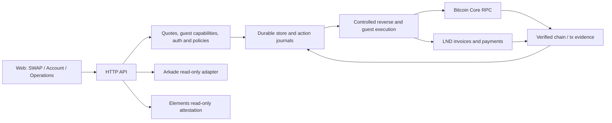

# Swap Engine

**A modular Bitcoin payment-rail swap engine built with TypeScript, Bitcoin Core, LND and an experimental Arkade integration.**

Swap Engine explores Lightning-to-Bitcoin reverse submarine swaps, noncustodial guest payments and extensible Bitcoin rails. The current project includes a three-cube web interface, server-side access control, a durable execution/recovery model and environment-verified infrastructure adapters.

> **Experimental software. No production/mainnet swap execution.** A successful build, quote, QR code or simulated transaction does not prove that funds moved. Mainnet and Signet profiles are **read-only**. Never use mainnet funds with an unreviewed deployment.

## Project status (November 23, 2026)

| Area | Current state | Evidence and boundaries |
| --- | --- | --- |
| Reverse swap, Lightning → Bitcoin | **Controlled regtest execution demonstrated; authenticated one-click flow merged** | [Independent recorded run](docs/fresh-reverse-success.md); [PR #68](https://github.com/Truja503/swap-engine/pull/68) established owner-bound runtime and [PR #75](https://github.com/Truja503/swap-engine/pull/75) simplified approved authenticated regtest preparation/execution. A live test on the newly deployed release is still a separate check |
| **Guest reverse swap, no account** | **Merged with QR, client-side claim, encrypted recovery and backup import** | [PR #71](https://github.com/Truja503/swap-engine/pull/71) integrated the flow; [PR #74](https://github.com/Truja503/swap-engine/pull/74) allows importing a saved encrypted recovery file in a new browser session. Real payment/claim/settlement evidence for the latest deployed commit is not established by browser fixtures |
| Network/deployment configuration | **Merged** | [PR #70](https://github.com/Truja503/swap-engine/pull/70): validated profiles, network/genesis/wallet checks, isolated state and fail-closed execution policies |
| Arkade / Ark | **Read-only operator/indexer and UI integrated** | [PR #73](https://github.com/Truja503/swap-engine/pull/73) adds readiness and VM overlay; [PR #76](https://github.com/Truja503/swap-engine/pull/76) adds owner-grouped balance cards that show unavailable until verified sources respond. Ark financial writes remain gated |
| Liquid / Elements | **Read-only balances and identity verification** | An Elements regtest profile checks chain, policy asset and wallet and reports real asset-filtered wallet balances in ADMIN Operations. No Liquid transfer, Liquid HTLC or Liquid-to-Lightning execution is enabled |
| Forward swap, Bitcoin → Lightning | **Not yet implemented end-to-end** | [#12](https://github.com/Truja503/swap-engine/issues/12), [#13](https://github.com/Truja503/swap-engine/issues/13) |
| Regtest block miner | **Script, systemd timer and tests prepared** | [#67](https://github.com/Truja503/swap-engine/issues/67); **not confirmed installed/enabled**. See [mining runbook](docs/regtest-mining.md) |
| RGB and other routes | **Future research** | No live cross-rail contract or payments in this application |

**Latest merged baseline:** [PR #76](https://github.com/Truja503/swap-engine/pull/76), commit `2741d8b4` (November 23, 2026). [PR #73](https://github.com/Truja503/swap-engine/pull/73) aligned the entered amount to the exact debit and added private history/readiness; [PR #74](https://github.com/Truja503/swap-engine/pull/74) added Guest backup import; [PR #75](https://github.com/Truja503/swap-engine/pull/75) added authenticated one-click reverse; [PR #76](https://github.com/Truja503/swap-engine/pull/76) added owner-grouped rail balances. PR #76 reports a successful build, 461 backend tests and 22 Edge/browser tests in its frontend verification; this is not a new live financial E2E run.

### Evidence of a real controlled reverse swap

The historical [November 18 regtest run](docs/fresh-reverse-success.md) documented:

| Item | Value |
| --- | ---: |
| Bitcoin HTLC principal | 50,000 sats |
| Lightning payment | 50,750 sats |
| Bitcoin received by Alice | 49,500 sats |
| Provider funding network fee | 306 sats |
| Claim network fee | 500 sats |
| Lightning routing fee | 0 sats |

The report includes the precise funding and claim TXIDs, Core chain confirmations, LND `SETTLED`/`SUCCEEDED` observations and independent reconciliation. **This test belongs to its authorized controlled profile.** The ADMIN historical-report endpoint transcribes evidence and is not itself a live blockchain proof.

## Architecture



- **Backend:** Node.js 22+, TypeScript, ESM, `tsx`, Zod.
- **Bitcoin:** `bitcoinjs-lib`, `ecpair`, `tiny-secp256k1`, scoped Bitcoin Core JSON-RPC.
- **Lightning:** LND HTTPS REST, verified TLS and separated macaroon permissions.
- **Browser:** three connected cubes for send, quote and receive; QR rendering, Account and ADMIN Operations.
- **Storage:** persistent single-writer journals, durable idempotency keys, network-bound state and conservative recovery.
- **Rails:** `onchain`, `lightning`, `ark`, `liquid`; each has typed configuration and capability reporting. Not every rail has an executable swap route.

A generic quote or configured rail **does not grant signing, broadcast, settlement or spending authority**. Controlled execution requires an explicit local policy and the correct verified node identities.

## Quick start: safe offline simulation

```bash
git clone https://github.com/Truja503/swap-engine.git
cd swap-engine
npm ci
npm run build
npm test

# A separate directory prevents accidental reuse of a regtest journal.
mkdir -p ./data/simulation
DATA_DIR=./data/simulation node --env-file=deploy/simulation.env.example --import tsx src/main.ts
```

Open **http://127.0.0.1:3000/**.

This preview runs without Bitcoin/LND credentials. It can present the UI and calculate quotes; it **cannot** create a real invoice, claim an HTLC, broadcast a transaction or settle a swap.

Useful development commands:

| Command | Purpose |
| --- | --- |
| `npm run build` | Type-check and build web assets |
| `npm test` | Backend and integration tests |
| `npm run test:web` | Browser integration tests (Playwright browser required) |
| `npm run demo` | **Offline** simulated coordinator demo |
| `npm run secrets:check` | Scan repository changes for secrets |
| `npm start` | Start the application; loads local `.env` when present |

Use `node --env-file=... --import tsx src/main.ts` to select a specific environment file explicitly. `npm start` reads a local `.env` via `scripts/load-local-env.mjs`; it does not automatically choose a profile from its filename.

## Environment-first configuration

As of [PR #70](https://github.com/Truja503/swap-engine/pull/70), deployments use validated environment profiles, **not hardcoded developer paths or wallet identities**.

| Profile | Intended use | Financial execution |
| --- | --- | --- |
| [`.env.regtest.example`](.env.regtest.example) | Bitcoin Core + LND isolated regtest | Disabled by default; reviewed guest/owned startup only |
| [`.env.signet.example`](.env.signet.example) | Signet read-only inspection | Disabled |
| [`.env.mainnet.example`](.env.mainnet.example) | Mainnet read-only inspection | **Disabled** |
| [`.env.ark.regtest.example`](.env.ark.regtest.example) | Ark operator and wallet observations | **Disabled** |
| [`.env.liquid.regtest.example`](.env.liquid.regtest.example) | Elements regtest identity/asset inspection | **Disabled** |

To prepare a private regtest profile:

```bash
cp .env.regtest.example .env.regtest.local
# Edit local absolute paths, wallet name, URLs, deployment ID and data directory.
# Do not copy real credentials into the repository.

node --env-file=.env.regtest.local --import tsx src/main.ts
```

Use a distinct `DEPLOYMENT_ID` and `DATA_DIR` per environment. On startup the application verifies Core network/genesis, the configured wallet and applicable LND identities before opening the journal. The `DATA_DIR/.environment.json` marker prevents silently reusing another network's state. A legacy journal needs an **offline, backup-first migration**; do not remove locks or overwrite old state.

Important configuration concepts:

```dotenv
APP_ENV=regtest
DEPLOYMENT_ID=replace-with-unique-deployment-id
DATA_DIR=/ABS/PATH/unique-regtest-state
SPEND_POLICY=disabled

BITCOIN_RPC_URL=http://127.0.0.1:18443
BITCOIN_COOKIE_PATH=/ABS/PATH/bitcoin-regtest/.cookie
BITCOIN_WALLET=replace-with-wallet

LND_REST_URL=https://127.0.0.1:8080
LND_TLS_CERT_PATH=/ABS/PATH/lnd/tls.cert
LND_MACAROON_PATH=/ABS/PATH/lnd/readonly.macaroon

REVERSE_SWAP_ENABLED=false
GUEST_SWAP_ENABLED=false
FORWARD_SWAP_ENABLED=false
REGTEST_AUTO_MINING=false
```

This is a **non-executing example**, not permission to replace an active service's settings.

- `APP_ENV` selects `simulation`, `regtest`, `signet`, `mainnet`, `ark-regtest` or `liquid-regtest`.
- `SPEND_POLICY=disabled` is the safe default. `regtest-only` is allowed only for reviewed regtest operation, and still requires a separate execution policy and authorization.
- `ENABLE_LIVE_SWAPS=true` does **not** unlock the system. Mainnet and Signet spending remain unavailable.
- Fee, amount and quote-expiry settings are validated, but **HTLC/confirmation security limits are not arbitrary environment switches**.
- `GET /v1/capabilities` reports whether each rail is configured, identity-verified and available. Availability does not imply spending authority.

See **[Environment-driven configuration](docs/environment-configuration.md)** for complete variables, expected identities, safe migration, quote economics and startup troubleshooting.

## Guest swap: Lightning → Bitcoin without an account

[Issue #66](https://github.com/Truja503/swap-engine/issues/66) tracks the full acceptance criteria.

The Guest implementation merged in PR #71 includes this browser flow:

1. Enter a valid `bcrt1...` Bitcoin regtest receiving address and amount.
2. Request and review a scoped, capability-protected quote.
3. Generate claim material and a payment preimage **inside the browser**.
4. Export and verify an **encrypted recovery bundle before a payable invoice is displayed**.
5. Prepare the hold invoice, display its BOLT11 request as a QR, and pay with a Lightning wallet.
6. Observe invoice state and verified Bitcoin funding, and sign a claim locally when allowed.
7. Reconcile settlement and confirmations; recover the guest swap using its saved material if necessary.

In a new browser session, choose **Restore Guest swap** on the Swap page. Open the complete encrypted JSON export and enter its passphrase. The browser checks the original swap and offers **Claim funds** only after its confirmed funding matches the backup. Restoring checks status without showing a payable invoice.

The recovery file, passphrase and private key stay in the browser. The existing Guest API uses the capability in its authorization header. The explicit claim submits the signed Bitcoin transaction, whose HTLC witness contains the preimage.

The backend stores the guest capability **hash** and public proof material, not the private claim key or preimage. Recovery encryption uses AES-GCM with a passphrase-based key derivation scheme. Keep both the recovery export and passphrase safe; losing them may make a claim unrecoverable.

As of [PR #74](https://github.com/Truja503/swap-engine/pull/74), a **new browser session can import an existing encrypted Guest recovery file** and verify the original swap identity and funding state before allowing an explicit claim. Importing the recovery file **must not generate a fresh payable invoice**.

Guest is **not activated by enabling its feature flag alone**. It requires the regtest spending policy, attested Core/LND identities, a reviewed private Guest policy and the dedicated watcher. After preparing and verifying the environment (see the detailed [configuration runbook](docs/environment-configuration.md)):

```bash
# Reviewed regtest profile only: GUEST_SWAP_ENABLED=true,
# SPEND_POLICY=regtest-only and matched private policy data.
node --env-file=.env.regtest.local --import tsx src/main.ts \
  --guest-regtest \
  --policy-path /ABS/PATH/guest-policy.json \
  --policy-sha256 REVIEWED_64_HEX_SHA256 \
  --guest-watch
```

This is a command **template**, not a ready-to-run policy. Never invent policy hashes, publish macaroon files or loosen execution gates to make it start.

**Public verification status:** merged source and automated Guest browser/recovery tests are verified. The PR states that a **new real Lightning-financial Guest test is still pending**. A locally running instance may have newer evidence, but it must be recorded with matching commit, LND states, on-chain TXIDs and recovery checks before updating that claim.

## Arkade: imported UI and isolated lab

[PR #71](https://github.com/Truja503/swap-engine/pull/71) integrates the Arkade selector into the existing three cubes and adds **read-only** operator telemetry, wallet observations and availability reporting to the backend. The adapter validates the configured Ark operator identity and uses an allowlisted, read-only laboratory CLI. Missing or unverifiable telemetry is reported as unavailable; historical transactions are not substituted as proof of new operations.

**Ark financial writes remain disabled**. A boarding or offboarding quote is not an executed transfer. `SUBMITTED` is not `CONFIRMED`, and neither a commitment TXID alone nor an Ark preconfirmation proves Lightning settlement.

The collaborator's independent Rust/Arkade regtest lab covers operator lifecycle, persistent wallets A/B, boarding, VTXO transfer, cooperative offboarding and restart/evidence testing. Its [cumulative PR #64](https://github.com/Truja503/swap-engine/pull/64) remains separate from this application's deployment. **Ark↔Lightning and Ark↔Liquid swaps are not implemented.** Do not assume the collaborator's isolated Bitcoin regtest blockchain shares UTXOs with the LND/Core lab.

Read [Ark configuration](docs/environment-configuration.md#ark-operator-and-wallet-telemetry), [Ark lab epic #46](https://github.com/Truja503/swap-engine/issues/46) and the [frontend behavior](docs/frontend.md) for the supported distinctions.

## Unified local regtest interface

Start the existing Admin and Guest services with their own regtest policies and
databases. The gateway serves the Admin interface and session on one loopback
origin, and forwards `/v1/guest/` to the Guest service using Guest recovery
capabilities. Use a signed-in browser for Admin's one-click flow and an
anonymous browser for Guest.

```sh
UNIFIED_BROWSER_ORIGIN=http://127.0.0.1:3100 \
UNIFIED_ADMIN_ORIGIN=http://127.0.0.1:3101 \
UNIFIED_GUEST_ORIGIN=http://127.0.0.1:3103 \
node --import tsx scripts/serve-unified-regtest.ts
```

For the additional Ark and Liquid balance cards, run the gateway with a
read-only regtest environment file. Set `UNIFIED_LIQUID_ALICE_WALLET` and
`UNIFIED_LIQUID_PROVIDER_WALLET` to the corresponding Elements wallet names.
For Ark, use `UNIFIED_ARK_ALICE_WALLET` and `UNIFIED_ARK_PROVIDER_WALLET` to map
the `alice` and `bob` lab wallets, alongside the pinned operator and read-only
CLI configuration. Balance requests still require the existing Admin session.

## Liquid / Elements

The `liquid-regtest` profile validates the configured Elements node, chain/genesis, wallet and policy asset using read-only calls. ADMIN Operations shows the configured wallet's real Liquid balances: confirmed, unconfirmed and spendable base units, UTXO count, asset ID, wallet, chain height and native genesis. Balances come from wallet-scoped `listunspent` filtered to the configured policy asset; startup also records whether a confirmed wallet UTXO matches an explicit tip coinbase asset. Current fee policy remains unproven (`feePolicyVerified=false`). These are Elements regtest units, not real BTC. `GET /v1/liquid/lightning/availability` reports the route and `POST /v1/liquid/lightning/quotes` and `/swaps` remain `503 LIQUID_LIGHTNING_ATOMIC_ADAPTER_UNAVAILABLE` until an attested atomic adapter is implemented. The profile does **not** enable L-BTC issuance, pegs, payments, Liquid HTLCs or Liquid↔Lightning swaps. Do not mistake a local Elements policy asset for the production Liquid L-BTC asset.

## Regtest mining: prepared, not automatically running

[Issue #67](https://github.com/Truja503/swap-engine/issues/67) has a versioned shell script, a systemd **user** service and a 10-minute timer with locking, pause, on-demand controls and regression tests.

**There is no published verification that the timer is installed and running on the VM.** The [mining runbook](docs/regtest-mining.md) explicitly keeps activation blocked until active swap execution/recovery shares the same kernel `flock` and height/CLTV protection is reviewed.

On this lab, `generatetoaddress` creates a regtest block without CPU/GPU mining. Each block advances CLTV deadlines. Do not enable the timer blindly while a swap or refund may be pending. Coinbase rewards are not swap revenue, and coinbase outputs require maturity before being spendable.

Service templates belong to the **user** service manager; inspect them with `systemctl --user`, not `sudo systemctl`:

```bash
systemctl --user list-unit-files | grep -E 'swap|miner'
systemctl --user list-timers --all
journalctl --user -u swap-engine.service -n 50 --no-pager
```

Always identify the service name and actual release commit before starting, stopping or changing an existing instance. See [deployment service instructions](docs/environment-configuration.md#service-installation).

## Selected HTTP endpoints

| Endpoint | Access | Meaning |
| --- | --- | --- |
| `GET /v1/health` | Public | Process liveness, **not** node readiness or execution authorization |
| `GET /v1/capabilities` | Public | Per-rail configuration and verified availability |
| `GET /v1/preflight` | Public | Node readiness diagnostics where configured |
| `POST /v1/quotes` | Public | Estimate only; does not move funds |
| `GET /v1/guest/availability` | Public | Whether the Guest runtime and watcher are mounted |
| `POST /v1/guest/quotes` | Capability admission | Guest quote request; subject to validation and rate limits |
| `GET /v1/guest/quotes/:id` | Guest capability | Guest status and recovery observation |
| `POST /v1/guest/quotes/:id/prepare` | Guest capability + idempotency | Explicit invoice preparation when Guest runtime is enabled |
| `POST /v1/guest/quotes/:id/claim` | Guest capability + idempotency | Submit a locally signed claim when authorized |
| `POST /v1/auth/login`, `GET /v1/auth/session`, `POST /v1/auth/logout` | Account session | Existing USER/ADMIN authentication |
| `GET /v1/reverse/availability` | Authenticated | Controlled reverse availability and execution authority |
| `POST /v1/reverse/preparations` | Approved owner | Durable owned preparation; not automatically a payment |
| `POST /v1/swaps/reverse` | Approved owner | Controlled, reviewed, idempotent regtest execution |
| `POST /v1/swaps/:id/reconcile` | Owner | Read-only conservative reconciliation |
| `GET /v1/operations/balances` | ADMIN | Core/LND balances and typed rail entries |
| `GET /v1/ark/telemetry` | ADMIN | Operator/wallet read-only Ark status when attested |
| `POST /v1/ark/quotes` | Public estimate | Indicative Ark↔on-chain quote; **not execution** |
| `POST /v1/ark/swaps` | Guarded/unavailable in shipped runtime | Ark financial writes are disabled |

Requests involving a payment or claim require stricter identity, network, quote, expiry, fee, revision and idempotency validation. Client UI status is never the financial source of truth.

## Running the current `main` yourself (Ubuntu VM)

**First rule: inspect the running deployment before starting another server.** A source checkout, a GitHub merge and an active systemd process can all point to different commits. Never reuse an active `DATA_DIR`, custody directory or wallet spending policy in a second app.

### 1. Inspect the actual lab without changing it

In the existing Ubuntu VM:

```bash
date -u
timedatectl status

systemctl --user list-units --type=service --all | grep -Ei 'swap|bitcoin|lnd|miner' || true
systemctl --user list-unit-files | grep -Ei 'swap|miner' || true
ss -ltnp | grep -E ':(3000|3100|3101|3103|3200)\b' || true
pgrep -af 'src/main.ts|swap-engine|tsx' || true
```

An old failed service named after a commit (for example `swap-engine-owned-434f519.service`) is **not proof that it runs the latest main**. The example `3103` port is not guaranteed to be active. Check the actual listener, then query its own port:

```bash
# Replace 3101 with a port confirmed by ss.
curl -fsS http://127.0.0.1:3101/v1/health
curl -fsS http://127.0.0.1:3101/v1/capabilities
curl -fsS http://127.0.0.1:3101/v1/guest/availability

# Inspect a real user unit; no sudo for --user.
systemctl --user status swap-engine-owned-434f519.service --no-pager -l
journalctl --user -u swap-engine-owned-434f519.service -n 50 --no-pager
```

`/v1/health` only confirms HTTP liveness. The Guest availability response must report both `configured: true` and `watching: true` before a payable Guest flow is attempted. Any startup failure may print only `APPLICATION_STARTUP_REJECTED`; inspect policy, identity, permissions, state locks, environment and port before restarting. Do not assume the NTP clock is the cause.

### 2. Run the latest main in a separate, safe preview

Do **not** run `git pull` directly into a checkout used by a live systemd service. For learning and verifying the repository, use a fresh directory and an independent simulation state:

```bash
cd "$HOME"
git clone https://github.com/Truja503/swap-engine.git swap-engine-main-review
cd swap-engine-main-review
git switch main
git log -1 --format='%h %s'
node --version                    # >= 22
npm ci
npm run build
npm test
npm run secrets:check

# This instance is simulation-only, with its own state and port.
install -d -m 700 "$HOME/.local/share/swap-engine-main-preview"
DATA_DIR="$HOME/.local/share/swap-engine-main-preview" PORT=3200 \
  node --env-file=deploy/simulation.env.example --import tsx src/main.ts
```

In a second Ubuntu shell:

```bash
curl -fsS http://127.0.0.1:3200/v1/health
curl -fsS http://127.0.0.1:3200/v1/capabilities
```

On Windows, if the VM still uses `192.168.56.108`, create an SSH tunnel in another PowerShell window:

```powershell
ssh -N -L 3200:127.0.0.1:3200 truja@192.168.56.108
```

Open `http://127.0.0.1:3200/`. Stop only this preview with **Ctrl+C** when finished. It does not create real Lightning invoices or spend on-chain funds.

### 3. Running actual regtest swaps

Use the **existing reviewed Guest deployment** or plan a backup-first cutover of the live service to the newer commit. Do not start a second spending application with the same Core/LND operator wallets merely because it uses a different TCP port or `DATA_DIR`: wallet-level funding reservations may conflict.

A new Guest deployment requires the profile and private policy described in [environment configuration](docs/environment-configuration.md#guest-lightning-to-on-chain-swaps):

```bash
# TEMPLATE ONLY: replace placeholders with a reviewed local policy.
node --env-file=.env.regtest.local --import tsx src/main.ts \
  --guest-regtest --policy-path /ABS/PATH/guest-policy.json \
  --policy-sha256 REVIEWED_64_HEX_SHA256 --guest-watch
```

Required conditions include `APP_ENV=regtest`, `GUEST_SWAP_ENABLED=true`, `SPEND_POLICY=regtest-only`, distinct LND provider/payer identities, valid macaroon/TLS paths, matching actual Bitcoin/LND regtest identities, fee/HTLC limits, a safe active-swap mining lock, and a reviewed private policy. Feature flags **do not** create policy authority. No placeholder values should be pasted into a live deployment.

`npm start` loads a local `.env` when present; it does not automatically choose `.env.regtest.local`. An explicit `node --env-file=...` avoids ambiguous profile selection. Keep source, credentials, encrypted run custody and live journal directories separate.

## Repeatable regtest swap testing (many swaps, safely)

The objective is to repeat **verified completed operations**, not to generate a pile of invoices or send payments to unknown states.

### Before each batch

1. Confirm the **deployed commit**, HTTP availability, Core regtest height, wallet readiness, and both LND nodes/channels. Use [VM preflight](docs/regtest-runbook.md) and `GET /v1/preflight`.
2. Verify **Alice outgoing Lightning liquidity**, provider capacity/UTXOs, and enough confirmed, unlocked Core inputs. A new on-chain funding input must be eligible for each run.
3. Review all existing `INTENT`, `PREPARATION_UNKNOWN`, `UNKNOWN`, `MANUAL_REVIEW` and pending invoice/claim records. Reconcile them **before** opening another financial intent. Never assume a timeout means a payment failed.
4. Keep the [automatic miner](docs/regtest-mining.md) disabled unless its shared kernel lock and CLTV controls have been reviewed and activated. Generate confirmation blocks **only** through the approved coordinated operator procedure.
5. Save evidence under a private test-results directory. Never log recovery material, preimages, capability tokens, macarons, passwords or private keys.

### Manual test matrix

| Test | Requested Lightning debit | Goal |
| --- | ---: | --- |
| G01 | 12,000 sats | Guest first successful reverse swap; verify the quoted net on-chain receipt |
| G02 | 20,000 sats | New guest identity, quote, invoice, recovery bundle and funding UTXO |
| G03 | 50,000 sats | Guest at the existing maximum invoice budget |
| G04 | 20,000 sats | Same amount as G02, but a **new** verified swap, never replay the paid invoice |
| G05 | No payment | Start/review a quote and intentionally stop; verify expiry and zero fund movement |
| G06 | No extra payment | Import G02/G03 encrypted recovery in a fresh browser session; verify lookup/claim eligibility without generating another invoice |
| G07 | No extra payment | Refresh the status of a pending run; verify idempotent lookup and no duplicate funding or settle |
| A01 | Amount within approved owned policy | Authenticated Admin one-click reverse, with explicit reviewed policy and eligible liquidity ([PR #75](https://github.com/Truja503/swap-engine/pull/75)) |

The test amounts are **proposed** within the current Guest range (11,000–50,000 sats), not guaranteed available quotes; the backend's verified liquidity, budget and policies decide eligibility. A01 can have an approved `maxSourceAmountSats` up to 1,000,000, but older approved policies remain capped at 50,000. Do not raise limits just to force a test.

### Exact manual Guest procedure

1. Open the **running regtest Guest application**, not the simulation preview. Select **Lightning → Bitcoin On-chain**, choose amount and enter a fresh valid `bcrt1...` receiving address that you control.
2. Inspect the quote's **invoice debit**, service/claim fees and expected on-chain payout. Do not pay if the amounts, network or address differ from what you authorized.
3. Create and **save the encrypted recovery bundle**, preserve its passphrase privately, and verify its import/restore step **before paying**.
4. Scan/copy the actual **BOLT11 QR** and pay from the existing Alice **regtest** Lightning wallet. Keep the pending payment running as required by the hold-invoice protocol; `ACCEPTED` is **not** `SETTLED`.
5. Observe real HTLC funding and confirmations. Only sign the claim in the browser when the application has independently verified the required funding and claim terms.
6. Reconcile the claim TXID, on-chain receipt, invoice `SETTLED`, payer `SUCCEEDED`, fees, network heights and terminal `COMPLETED`. Use the node evidence, not a frontend banner, as the source of truth.
7. Only after terminal verification, begin the next **fresh** swap. Preserve all prior journals and encrypted recovery exports.

For each successful run record: timestamp, deployed commit, environment/deployment ID, swap ID, sats debited, sats received, quoted vs actual fees, funding TXID and outpoint, claim TXID, confirmations, LND payment/invoice status, restart/recovery result and exceptions. Keep the record sanitized.

### Scaling from 3 to 10+ swaps

Start **sequentially**, with G01–G04 and completion evidence for every run. Next perform ten small sequential swaps with a fresh capability, invoice, recovery export and idempotency key per **new** intent. **Retry the same unresolved intent using its original key/status lookup**; do not create a second operation because of a timeout or lost HTTP response.

Only consider concurrency and automated load generation **after** proving cross-swap UTXO reservations, liquidity ceilings, LND invoice identity, worker restart/recovery, miner lock coordination, deadline behavior and idempotent exact-once financial intent admission. Browser tests using mocks/fixtures are useful regression checks but do not constitute ten financial transactions.

If an invoice stays `ACCEPTED`, claim is unconfirmed, or an operation enters `UNKNOWN`/`MANUAL_REVIEW`, **stop the batch**, inspect readonly evidence, and do not force-mine or repeat payment.

See [Guest contract #66](https://github.com/Truja503/swap-engine/issues/66), [environment and owner policy](docs/environment-configuration.md), [mining safety](docs/regtest-mining.md) and the [historical verified reverse run](docs/fresh-reverse-success.md).

## Security, limitations and roadmap

- **Mainnet execution is unavailable.** Switching `APP_ENV` to mainnet does not unlock the signer, payer or mining.
- Fund custody must remain explicit. Browser claim secrets must not appear in server logs, URL parameters or Git history.
- Readiness, execution authorization, confirmation and settlement are **different** conditions.
- Unknown external RPC results must be reconciled before trying another financial action. Do not repeat payments or broadcasts to "fix" an error.
- Never reuse a spent UTXO, a previously settled invoice or an expired operator approval.
- State directories are single-writer and tied to verified deployment/network identity; do not erase lockfiles or migrate by copying one network's journal into another.
- The current project is not a production-grade, externally audited public swapping service.

**Next milestones:**

1. Record and verify one full **Guest browser → real Lightning → confirmed Bitcoin** test against the exact merged deployment; complete [#66](https://github.com/Truja503/swap-engine/issues/66) only with supporting evidence.
2. Finish miner/CLTV coordination and controlled VM activation with actual timer observations; [#67](https://github.com/Truja503/swap-engine/issues/67).
3. Audit and independently verify any Ark write adapter before enabling boarding/offboarding from the web; continue the isolated [Ark lab #46](https://github.com/Truja503/swap-engine/issues/46).
4. Implement a real **Bitcoin on-chain → Lightning** forward swap with refund/reorg recovery; [#12](https://github.com/Truja503/swap-engine/issues/12) and [#13](https://github.com/Truja503/swap-engine/issues/13).
5. Develop Liquid/Elements live integration behind its own verifiable adapter and test matrix.
6. Complete independent protocol/security reviews, reproducible CI/E2E evidence and operational hardening before considering broader deployment.

Track progress in the [master issue #43](https://github.com/Truja503/swap-engine/issues/43).

## Licensing and contributions

The repository is public, but its current `LICENSE` reserves all rights. **Public visibility is not an open-source license**. Do not assume permission to reuse proprietary code or third-party assets beyond their license terms.

Before a PR: preserve existing worktrees, run `npm run build`, `npm test`, `npm run secrets:check` and relevant browser/lab tests. State whether each result was simulated, run against mocked adapters, verified on live regtest nodes, or deployed. Include commit hashes, relevant TXIDs and known limitations without secrets.

Repository: [Truja503/swap-engine](https://github.com/Truja503/swap-engine).
