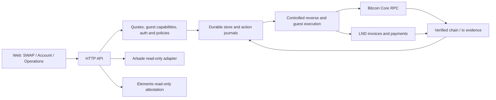

# Swap Engine

**A modular Bitcoin payment-rail swap engine built with TypeScript, Bitcoin Core, LND and an experimental Arkade integration.**

Swap Engine explores Lightning-to-Bitcoin reverse submarine swaps, noncustodial guest payments and extensible Bitcoin rails. The current project includes a three-cube web interface, server-side access control, a durable execution/recovery model and environment-verified infrastructure adapters.

> **Experimental software. No production/mainnet swap execution.** A successful build, quote, QR code or simulated transaction does not prove that funds moved. Mainnet and Signet profiles are **read-only**. Never use mainnet funds with an unreviewed deployment.

## Project status (November 22, 2026)

| Area | Current state | Evidence and boundaries |
| --- | --- | --- |
| Reverse swap, Lightning → Bitcoin | **Controlled regtest execution demonstrated** | [Independent recorded run](docs/fresh-reverse-success.md); owner-bound application integrated in [PR #68](https://github.com/Truja503/swap-engine/pull/68) |
| **Guest reverse swap, no account** | **Implemented in `main`; laboratory execution is policy-gated** | [PR #71](https://github.com/Truja503/swap-engine/pull/71) includes destination entry, hold-invoice creation, BOLT11 QR, client-held recovery material, browser claim signing and state observation. Automated browser/adapter tests passed. The PR does **not** claim a new live Guest Lightning E2E payment; verify independently before declaring #66 complete |
| Network/deployment configuration | **Merged** | [PR #70](https://github.com/Truja503/swap-engine/pull/70): validated profiles, network/genesis/wallet checks, isolated state and fail-closed execution policies |
| Arkade / Ark | **Read-only operator and wallet integration in `main`** | [PR #71](https://github.com/Truja503/swap-engine/pull/71). Lab evidence exists in the separate [Ark PR stack](https://github.com/Truja503/swap-engine/pull/64), but the app does not enable Ark financial execution or Ark↔Lightning swaps |
| Liquid / Elements | **Read-only configuration/identity verification** | An Elements regtest profile checks chain, policy asset and wallet. No Liquid transfer/swap execution is enabled |
| Forward swap, Bitcoin → Lightning | **Not yet implemented end-to-end** | [#12](https://github.com/Truja503/swap-engine/issues/12), [#13](https://github.com/Truja503/swap-engine/issues/13) |
| Regtest block miner | **Script, systemd timer and tests prepared** | [#67](https://github.com/Truja503/swap-engine/issues/67); **not confirmed installed/enabled**. See [mining runbook](docs/regtest-mining.md) |
| RGB and other routes | **Future research** | No live cross-rail contract or payments in this application |

**Most recent merged integration:** [PR #71](https://github.com/Truja503/swap-engine/pull/71), merged at commit `b10e4a79`. Its reported validation: **479 tests passed, one skipped, 20 browser tests passed, and zero secret findings**, with a successful Linux CI workflow. Those are tests of the merged implementation, not proof of a newly executed Guest payment on physical nodes.

### Evidence of a real controlled reverse swap

The historical [November 18 regtest run](docs/fresh-reverse-success.md) documented:

| Item | Value |
| --- | ---: |
| Bitcoin HTLC principal | 50,000 sats |
| Lightning payment | 50,750 sats |
| Bitcoin received by Alice | 49,500 sats |
| Provider funding network fee | 306 sats |
| Claim network fee | 500 sats |
| Lightning routing fee | 0 sats |

The report includes the precise funding and claim TXIDs, Core chain confirmations, LND `SETTLED`/`SUCCEEDED` observations and independent reconciliation. **This test belongs to its authorized controlled profile.** The ADMIN historical-report endpoint transcribes evidence and is not itself a live blockchain proof.

## Architecture



- **Backend:** Node.js 22+, TypeScript, ESM, `tsx`, Zod.
- **Bitcoin:** `bitcoinjs-lib`, `ecpair`, `tiny-secp256k1`, scoped Bitcoin Core JSON-RPC.
- **Lightning:** LND HTTPS REST, verified TLS and separated macaroon permissions.
- **Browser:** three connected cubes for send, quote and receive; QR rendering, Account and ADMIN Operations.
- **Storage:** persistent single-writer journals, durable idempotency keys, network-bound state and conservative recovery.
- **Rails:** `onchain`, `lightning`, `ark`, `liquid`; each has typed configuration and capability reporting. Not every rail has an executable swap route.

A generic quote or configured rail **does not grant signing, broadcast, settlement or spending authority**. Controlled execution requires an explicit local policy and the correct verified node identities.

## Quick start: safe offline simulation

```bash
git clone https://github.com/Truja503/swap-engine.git
cd swap-engine
npm ci
npm run build
npm test

# A separate directory prevents accidental reuse of a regtest journal.
mkdir -p ./data/simulation
DATA_DIR=./data/simulation node --env-file=deploy/simulation.env.example --import tsx src/main.ts
```

Open **http://127.0.0.1:3000/**.

This preview runs without Bitcoin/LND credentials. It can present the UI and calculate quotes; it **cannot** create a real invoice, claim an HTLC, broadcast a transaction or settle a swap.

Useful development commands:

| Command | Purpose |
| --- | --- |
| `npm run build` | Type-check and build web assets |
| `npm test` | Backend and integration tests |
| `npm run test:web` | Browser integration tests (Playwright browser required) |
| `npm run demo` | **Offline** simulated coordinator demo |
| `npm run secrets:check` | Scan repository changes for secrets |
| `npm start` | Start the application; loads local `.env` when present |

Use `node --env-file=... --import tsx src/main.ts` to select a specific environment file explicitly. `npm start` reads a local `.env` via `scripts/load-local-env.mjs`; it does not automatically choose a profile from its filename.

## Environment-first configuration

As of [PR #70](https://github.com/Truja503/swap-engine/pull/70), deployments use validated environment profiles, **not hardcoded developer paths or wallet identities**.

| Profile | Intended use | Financial execution |
| --- | --- | --- |
| [`.env.regtest.example`](.env.regtest.example) | Bitcoin Core + LND isolated regtest | Disabled by default; reviewed guest/owned startup only |
| [`.env.signet.example`](.env.signet.example) | Signet read-only inspection | Disabled |
| [`.env.mainnet.example`](.env.mainnet.example) | Mainnet read-only inspection | **Disabled** |
| [`.env.ark.regtest.example`](.env.ark.regtest.example) | Ark operator and wallet observations | **Disabled** |
| [`.env.liquid.regtest.example`](.env.liquid.regtest.example) | Elements regtest identity/asset inspection | **Disabled** |

To prepare a private regtest profile:

```bash
cp .env.regtest.example .env.regtest.local
# Edit local absolute paths, wallet name, URLs, deployment ID and data directory.
# Do not copy real credentials into the repository.

node --env-file=.env.regtest.local --import tsx src/main.ts
```

Use a distinct `DEPLOYMENT_ID` and `DATA_DIR` per environment. On startup the application verifies Core network/genesis, the configured wallet and applicable LND identities before opening the journal. The `DATA_DIR/.environment.json` marker prevents silently reusing another network's state. A legacy journal needs an **offline, backup-first migration**; do not remove locks or overwrite old state.

Important configuration concepts:

```dotenv
APP_ENV=regtest
DEPLOYMENT_ID=replace-with-unique-deployment-id
DATA_DIR=/ABS/PATH/unique-regtest-state
SPEND_POLICY=disabled

BITCOIN_RPC_URL=http://127.0.0.1:18443
BITCOIN_COOKIE_PATH=/ABS/PATH/bitcoin-regtest/.cookie
BITCOIN_WALLET=replace-with-wallet

LND_REST_URL=https://127.0.0.1:8080
LND_TLS_CERT_PATH=/ABS/PATH/lnd/tls.cert
LND_MACAROON_PATH=/ABS/PATH/lnd/readonly.macaroon

REVERSE_SWAP_ENABLED=false
GUEST_SWAP_ENABLED=false
FORWARD_SWAP_ENABLED=false
REGTEST_AUTO_MINING=false
```

This is a **non-executing example**, not permission to replace an active service's settings.

- `APP_ENV` selects `simulation`, `regtest`, `signet`, `mainnet`, `ark-regtest` or `liquid-regtest`.
- `SPEND_POLICY=disabled` is the safe default. `regtest-only` is allowed only for reviewed regtest operation, and still requires a separate execution policy and authorization.
- `ENABLE_LIVE_SWAPS=true` does **not** unlock the system. Mainnet and Signet spending remain unavailable.
- Fee, amount and quote-expiry settings are validated, but **HTLC/confirmation security limits are not arbitrary environment switches**.
- `GET /v1/capabilities` reports whether each rail is configured, identity-verified and available. Availability does not imply spending authority.

See **[Environment-driven configuration](docs/environment-configuration.md)** for complete variables, expected identities, safe migration, quote economics and startup troubleshooting.

## Guest swap: Lightning → Bitcoin without an account

[Issue #66](https://github.com/Truja503/swap-engine/issues/66) tracks the full acceptance criteria.

The Guest implementation merged in PR #71 includes this browser flow:

1. Enter a valid `bcrt1...` Bitcoin regtest receiving address and amount.
2. Request and review a scoped, capability-protected quote.
3. Generate claim material and a payment preimage **inside the browser**.
4. Export and verify an **encrypted recovery bundle before a payable invoice is displayed**.
5. Prepare the hold invoice, display its BOLT11 request as a QR, and pay with a Lightning wallet.
6. Observe invoice state and verified Bitcoin funding, and sign a claim locally when allowed.
7. Reconcile settlement and confirmations; recover the guest swap using its saved material if necessary.

The backend stores the guest capability **hash** and public proof material, not the private claim key or preimage. Recovery encryption uses AES-GCM with a passphrase-based key derivation scheme. Keep both the recovery export and passphrase safe; losing them may make a claim unrecoverable.

Guest is **not activated by enabling its feature flag alone**. It requires the regtest spending policy, attested Core/LND identities, a reviewed private Guest policy and the dedicated watcher. After preparing and verifying the environment (see the detailed [configuration runbook](docs/environment-configuration.md)):

```bash
# Reviewed regtest profile only: GUEST_SWAP_ENABLED=true,
# SPEND_POLICY=regtest-only and matched private policy data.
node --env-file=.env.regtest.local --import tsx src/main.ts \
  --guest-regtest \
  --policy-path /ABS/PATH/guest-policy.json \
  --policy-sha256 REVIEWED_64_HEX_SHA256 \
  --guest-watch
```

This is a command **template**, not a ready-to-run policy. Never invent policy hashes, publish macaroon files or loosen execution gates to make it start.

**Public verification status:** merged source and automated Guest browser/recovery tests are verified. The PR states that a **new real Lightning-financial Guest test is still pending**. A locally running instance may have newer evidence, but it must be recorded with matching commit, LND states, on-chain TXIDs and recovery checks before updating that claim.

## Arkade: imported UI and isolated lab

[PR #71](https://github.com/Truja503/swap-engine/pull/71) integrates the Arkade selector into the existing three cubes and adds **read-only** operator telemetry, wallet observations and availability reporting to the backend. The adapter validates the configured Ark operator identity and uses an allowlisted, read-only laboratory CLI. Missing or unverifiable telemetry is reported as unavailable; historical transactions are not substituted as proof of new operations.

**Ark financial writes remain disabled**. A boarding or offboarding quote is not an executed transfer. `SUBMITTED` is not `CONFIRMED`, and neither a commitment TXID alone nor an Ark preconfirmation proves Lightning settlement.

The collaborator's independent Rust/Arkade regtest lab covers operator lifecycle, persistent wallets A/B, boarding, VTXO transfer, cooperative offboarding and restart/evidence testing. Its [cumulative PR #64](https://github.com/Truja503/swap-engine/pull/64) remains separate from this application's deployment. **Ark↔Lightning and Ark↔Liquid swaps are not implemented.** Do not assume the collaborator's isolated Bitcoin regtest blockchain shares UTXOs with the LND/Core lab.

Read [Ark configuration](docs/environment-configuration.md#ark-operator-and-wallet-telemetry), [Ark lab epic #46](https://github.com/Truja503/swap-engine/issues/46) and the [frontend behavior](docs/frontend.md) for the supported distinctions.

## Liquid / Elements

The `liquid-regtest` profile validates the configured Elements node, chain/genesis, wallet and policy asset using read-only calls. The profile does **not** enable L-BTC issuance, pegs, payments, Liquid HTLCs or Liquid↔Lightning swaps. Do not mistake a local Elements policy asset for the production Liquid L-BTC asset.

## Regtest mining: prepared, not automatically running

[Issue #67](https://github.com/Truja503/swap-engine/issues/67) has a versioned shell script, a systemd **user** service and a 10-minute timer with locking, pause, on-demand controls and regression tests.

**There is no published verification that the timer is installed and running on the VM.** The [mining runbook](docs/regtest-mining.md) explicitly keeps activation blocked until active swap execution/recovery shares the same kernel `flock` and height/CLTV protection is reviewed.

On this lab, `generatetoaddress` creates a regtest block without CPU/GPU mining. Each block advances CLTV deadlines. Do not enable the timer blindly while a swap or refund may be pending. Coinbase rewards are not swap revenue, and coinbase outputs require maturity before being spendable.

Service templates belong to the **user** service manager; inspect them with `systemctl --user`, not `sudo systemctl`:

```bash
systemctl --user list-unit-files | grep -E 'swap|miner'
systemctl --user list-timers --all
journalctl --user -u swap-engine.service -n 50 --no-pager
```

Always identify the service name and actual release commit before starting, stopping or changing an existing instance. See [deployment service instructions](docs/environment-configuration.md#service-installation).

## Selected HTTP endpoints

| Endpoint | Access | Meaning |
| --- | --- | --- |
| `GET /v1/health` | Public | Process liveness, **not** node readiness or execution authorization |
| `GET /v1/capabilities` | Public | Per-rail configuration and verified availability |
| `GET /v1/preflight` | Public | Node readiness diagnostics where configured |
| `POST /v1/quotes` | Public | Estimate only; does not move funds |
| `GET /v1/guest/availability` | Public | Whether the Guest runtime and watcher are mounted |
| `POST /v1/guest/quotes` | Capability admission | Guest quote request; subject to validation and rate limits |
| `GET /v1/guest/quotes/:id` | Guest capability | Guest status and recovery observation |
| `POST /v1/guest/quotes/:id/prepare` | Guest capability + idempotency | Explicit invoice preparation when Guest runtime is enabled |
| `POST /v1/guest/quotes/:id/claim` | Guest capability + idempotency | Submit a locally signed claim when authorized |
| `POST /v1/auth/login`, `GET /v1/auth/session`, `POST /v1/auth/logout` | Account session | Existing USER/ADMIN authentication |
| `GET /v1/reverse/availability` | Authenticated | Controlled reverse availability and execution authority |
| `POST /v1/reverse/preparations` | Approved owner | Durable owned preparation; not automatically a payment |
| `POST /v1/swaps/reverse` | Approved owner | Controlled, reviewed, idempotent regtest execution |
| `POST /v1/swaps/:id/reconcile` | Owner | Read-only conservative reconciliation |
| `GET /v1/operations/balances` | ADMIN | Core/LND balances and typed rail entries |
| `GET /v1/ark/telemetry` | ADMIN | Operator/wallet read-only Ark status when attested |
| `POST /v1/ark/quotes` | Public estimate | Indicative Ark↔on-chain quote; **not execution** |
| `POST /v1/ark/swaps` | Guarded/unavailable in shipped runtime | Ark financial writes are disabled |

Requests involving a payment or claim require stricter identity, network, quote, expiry, fee, revision and idempotency validation. Client UI status is never the financial source of truth.

## Security, limitations and roadmap

- **Mainnet execution is unavailable.** Switching `APP_ENV` to mainnet does not unlock the signer, payer or mining.
- Fund custody must remain explicit. Browser claim secrets must not appear in server logs, URL parameters or Git history.
- Readiness, execution authorization, confirmation and settlement are **different** conditions.
- Unknown external RPC results must be reconciled before trying another financial action. Do not repeat payments or broadcasts to "fix" an error.
- Never reuse a spent UTXO, a previously settled invoice or an expired operator approval.
- State directories are single-writer and tied to verified deployment/network identity; do not erase lockfiles or migrate by copying one network's journal into another.
- The current project is not a production-grade, externally audited public swapping service.

**Next milestones:**

1. Record and verify one full **Guest browser → real Lightning → confirmed Bitcoin** test against the exact merged deployment; complete [#66](https://github.com/Truja503/swap-engine/issues/66) only with supporting evidence.
2. Finish miner/CLTV coordination and controlled VM activation with actual timer observations; [#67](https://github.com/Truja503/swap-engine/issues/67).
3. Audit and independently verify any Ark write adapter before enabling boarding/offboarding from the web; continue the isolated [Ark lab #46](https://github.com/Truja503/swap-engine/issues/46).
4. Implement a real **Bitcoin on-chain → Lightning** forward swap with refund/reorg recovery; [#12](https://github.com/Truja503/swap-engine/issues/12) and [#13](https://github.com/Truja503/swap-engine/issues/13).
5. Develop Liquid/Elements live integration behind its own verifiable adapter and test matrix.
6. Complete independent protocol/security reviews, reproducible CI/E2E evidence and operational hardening before considering broader deployment.

Track progress in the [master issue #43](https://github.com/Truja503/swap-engine/issues/43).

## Licensing and contributions

The repository is public, but its current `LICENSE` reserves all rights. **Public visibility is not an open-source license**. Do not assume permission to reuse proprietary code or third-party assets beyond their license terms.

Before a PR: preserve existing worktrees, run `npm run build`, `npm test`, `npm run secrets:check` and relevant browser/lab tests. State whether each result was simulated, run against mocked adapters, verified on live regtest nodes, or deployed. Include commit hashes, relevant TXIDs and known limitations without secrets.

Repository: [Truja503/swap-engine](https://github.com/Truja503/swap-engine).
