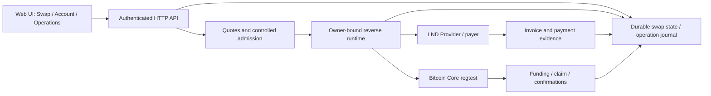

# Swap Engine

**Experimental Bitcoin payment-rail swap engine, developed and tested on regtest.**

Swap Engine is a TypeScript project for exchanging value between Bitcoin on-chain and Lightning without requiring a Lightning channel to be closed. It combines a Bitcoin HTLC, Lightning hold invoices, a durable swap state machine, and an authenticated web interface.

> **Regtest only. Not audited for production. Do not deposit mainnet funds.** The normal application starts with financial execution disabled. Controlled reverse-swap execution is a separately configured, owner-bound laboratory capability, **not** an unrestricted public payment service.

## Current status — November 2026

| Capability | Status | Evidence / limitation |
| --- | --- | --- |
| Bitcoin regtest + LND connectivity | Implemented | Read-only node diagnostics, balances and liquidity inspection; requires existing configured nodes |
| Lightning → Bitcoin on-chain (reverse swap) | **Verified in a controlled regtest run** | Funding and claim TXIDs, confirmed output, and LND payment/invoice settlement recorded in [the test report](docs/fresh-reverse-success.md) |
| Authenticated reverse-swap application | **Merged into `main`** | [PR #68](https://github.com/Truja503/swap-engine/pull/68): owner-bound preparation, execution, status and conservative recovery. Explicit private runtime policy required; default is closed |
| Standard quote + web experience | Available | Three-cube interface, live quote requests, Account and ADMIN Operations; unsupported routes do not execute |
| Guest reverse swap (no account) | **In progress, not released** | [#66](https://github.com/Truja503/swap-engine/issues/66): Bitcoin destination → BOLT11 invoice/QR → safe claim → receipt. A guest quote/capability prototype was reported in a **local** worktree; it is not verified as merged or deployed |
| Bitcoin on-chain → Lightning (forward swap) | Not implemented end-to-end | [#12](https://github.com/Truja503/swap-engine/issues/12), [#13](https://github.com/Truja503/swap-engine/issues/13) |
| Automatic regtest block generation | Planned / not confirmed deployed | [#67](https://github.com/Truja503/swap-engine/issues/67); coordinate with HTLC/CLTV deadlines |
| Liquid / L-BTC | Planned | Elements regtest and adapters not yet validated in this application's deployed backend |
| Arkade | Independent regtest lab under review | [Ark epic #46](https://github.com/Truja503/swap-engine/issues/46); external lab PRs do not imply an integrated Ark swap route |
| RGB and other rails | Research / future work | No verified cross-rail execution exposed by this app |

**What has actually been demonstrated?** The controlled reverse-swap report documents a **50,000-sat** HTLC, **50,750 sats** paid by Lightning, **49,500 sats** received on-chain, funding fee **306 sats**, claim fee **500 sats**, routing fee **0 sats**, and independent Core/LND checks. The successful test is specific to its approved profile. The newer **exact-Lightning-debit** quote mode in PR #68 passed synthetic-node tests; a new real payment with that precise quote profile has **not** been claimed.

The PR #68 report lists **387 passing tests, one platform skip, zero failures**, with a successful `Verify components` workflow. Browser tests with synthetic node adapters are not substitutes for a live regtest payment. A merge to `main` is also not proof that the VM is running that commit.

## What the application does

For a **reverse submarine swap** (Lightning → Bitcoin):

1. A quote determines invoice amount, on-chain principal, fees, and limits.
2. The provider creates a Lightning hold invoice sharing a payment hash with the Bitcoin HTLC.
3. A bounded, journaled execution accepts the Lightning payment and verifies the appropriate Bitcoin funding.
4. The client claims the HTLC to its on-chain destination, revealing the preimage.
5. The provider settles the hold invoice only after validated on-chain evidence.
6. The system reconciles confirmed transactions and Lightning states; uncertain results remain pending or require manual review.

A hold invoice marked `ACCEPTED` is **not** `SETTLED`. An HTTP response, quote, test fixture, or animated success state is not proof of financial completion.

### High-level architecture



The generic HTTP server does **not** accept unrestricted spending instructions. The execution runtime relies on local, protected operator configuration and wallet credentials outside the repository. Owner identity is obtained from server-side sessions, not client-submitted JSON fields.

## Tech stack

- **TypeScript / Node.js 22+**; ESM and `tsx`.
- Bitcoin transactions and HTLC components using `bitcoinjs-lib`, `ecpair`, and `tiny-secp256k1`.
- **Bitcoin Core** JSON-RPC and **LND** HTTPS REST, with TLS certificate and macaroon verification.
- Zod schemas, a persistent single-writer store, and idempotent execution/reconciliation.
- A monochrome 3D-inspired web interface, with browser integration tests.
- Ubuntu VM / systemd user services for the isolated regtest laboratory.

## Quick start: safe offline preview

```bash
git clone https://github.com/Truja503/swap-engine.git
cd swap-engine
npm ci
npm run build
npm test
cp deploy/simulation.env.example .env.simulation
node --env-file=.env.simulation --import tsx src/main.ts
```

Open **http://127.0.0.1:3000/** (or the configured `PORT`).

This starts a **simulation/component preview**. It can show quotes, UI and component status. **It does not pay invoices, sign claims, broadcast transactions or execute real swaps.** No node credentials are needed for simulation.

Additional checks:

```bash
npm run test:web
npm run demo
npm run secrets:check
```

The offline demo uses simulated Bitcoin/LND evidence and must not be presented as a real payment.

## Read-only Bitcoin + Lightning regtest

Use an **existing isolated lab** with Bitcoin Core, the `lqwd-lab` wallet and both LND nodes already configured. Do not reset the blockchain, replace wallets, destroy channels or copy macaroon/password material into the repository.

```bash
cp deploy/regtest.env.example .env.regtest
# Review local RPC URLs and certificate/cookie/macaroon file paths.
node --env-file=.env.regtest --import tsx scripts/inspect.ts
node --env-file=.env.regtest --import tsx src/main.ts
```

- `APP_MODE=regtest` selects actual **read-only** local node diagnostics.
- Keep `ENABLE_LIVE_SWAPS=false`. Setting it to `true` does **not** safely activate the controlled runner.
- The LND gRPC port is **not** its HTTPS REST endpoint.
- `GET /v1/health` is a liveness check; `GET /v1/preflight` evaluates node readiness. **Neither authorizes execution.**
- The default listener binds to loopback. Connect to a VM using a reviewed SSH tunnel rather than exposing wallet RPCs.

See [Ubuntu deployment](docs/ubuntu-deployment.md), [regtest runbook](docs/regtest-runbook.md), and [runtime verification](docs/vm-controlled-runtime-verification.md).

### Controlled owner-bound reverse swaps

[PR #68](https://github.com/Truja503/swap-engine/pull/68) integrates a separate, **explicitly enabled** regtest runtime with owner-bound authorization, durable preparation/admission, status and read-only reconciliation. It requires existing approved identities, custody, inputs, destinations, fee limits and local policy files. A normal `npm start` does not supply those authorizations.

Start from these documents rather than guessing environment flags or removing an HTTP 503 gate:

- [Owned regtest self-service](docs/owned-regtest-self-service.md)
- [Controlled reverse HTTP contract](docs/owned-regtest-api.md)
- [Integrated gateway and startup](docs/integrated-owned-reverse.md)
- [Execution and recovery boundaries](docs/controlled-execution.md)
- [Verified internal reverse-swap evidence](docs/fresh-reverse-success.md)

**Do not reuse** the historical paid invoice, spent funding outpoint or expired approval for a new operation. Unexpected RPC outcomes must be reconciled, not retried blindly.

## HTTP API: selected endpoints

| Route | Access | Purpose |
| --- | --- | --- |
| `POST /v1/quotes` | Public | Estimate Lightning/on-chain amounts and fees; not execution |
| `POST /v1/auth/login`, `GET /v1/auth/session`, `POST /v1/auth/logout` | Session APIs | USER/ADMIN authentication; protected writes require origin + CSRF |
| `GET /v1/health` | Public | Process/component liveness |
| `GET /v1/preflight` | Public | Regtest readiness diagnostics when configured |
| `GET /v1/operations/balances` | ADMIN | Read-only Core and LND balances/channel liquidity |
| `GET /v1/admin/swaps/historical` | ADMIN | Historical report transcription; **not a live chain-verification endpoint** |
| `GET /v1/reverse/availability` | Authenticated | Whether a controlled owner-bound runtime is actually mounted and available |
| `GET /v1/swaps`, `GET /v1/swaps/:id` | Bound owner, when configured | Prepared swap status and evidence |
| `POST /v1/reverse/preparations` | Approved owner, when configured | Durable preparation admission; not a payment |
| `POST /v1/swaps/reverse` | Approved owner + prepared swap, when configured | Explicit, idempotent controlled execution |
| `POST /v1/swaps/:id/reconcile` | Bound owner, when configured | Read-only conservative recovery lookup |

The controlled endpoints are **not necessarily mounted on every deployment**. Where the runtime is unavailable, the operation remains gated. Follow [the canonical API contract](docs/owned-regtest-api.md) and [self-service preparation contract](docs/owned-regtest-self-service.md) for exact bodies, security headers, state transitions and response codes.

The historical ADMIN record intentionally shows `UNVERIFIED` because that endpoint transcribes a report rather than independently querying current Core/LND state, even though the [original run report](docs/fresh-reverse-success.md) documents independent verification at test time.

## Interface and operational monitoring

The web app contains:

- **Swap:** a minimalist three-cube send / fee / receive flow, route selectors and quotes.
- **Account:** session management, signed-in user state and role-specific views.
- **Operations (ADMIN):** balances and channel liquidity from the configured Bitcoin Core/LND sources. Four indicators distinguish provider on-chain, provider Lightning, Alice Lightning and Alice on-chain balances.
- **Prepared swap / history views:** status, actual transaction IDs and conservative execution/recovery states where the backend has trustworthy evidence.

Channel **local** and **remote** balances are liquidity distribution, not separate Bitcoin reserves. Coinbase mining rewards, channel movements and swap principal must not be conflated when reconciling before/after balance changes.

## Guest swap — highest-priority work in progress

See [Issue #66](https://github.com/Truja503/swap-engine/issues/66). Intended guest UX:

1. Enter a regtest Bitcoin receiving address and amount, without signing in.
2. Review exact expected receipt, fees and expiry.
3. Receive a real BOLT11 Lightning invoice and a QR code.
4. Pay using a Lightning wallet; observe pending/accepted/settled states.
5. Claim and confirm the Bitcoin output securely.
6. Refresh or recover the swap and inspect verified TXIDs and fee reconciliation.

**This flow is not finished or released.** A reported local DeepSeek branch (`review/guest-capability-admission`, checkpoint `cd2920b`) added a disabled-by-default guest quote/capability prototype with 14 tests, but **that local checkpoint must be recovered, compared with current `main`, and reviewed**. Do not infer that it is published from the merged reverse-swap PR.

The no-account workflow must solve claim-key/preimage custody and backup/recovery before presenting a payable invoice. A receiving address alone is insufficient to provide a trustless claim key. Guest access must use scoped capability authorization, keep secrets out of logs and URLs, and preserve existing ADMIN/USER separation.

## Roadmap

1. **P0 — Guest reverse swap:** [#66](https://github.com/Truja503/swap-engine/issues/66). Recover DeepSeek's existing local work, complete secure invoice/QR/claim/recovery, and prove a full browser-initiated regtest payment.
2. **P0 — Regtest block automation:** [#67](https://github.com/Truja503/swap-engine/issues/67). One Bitcoin regtest block around every 10 minutes, with pause/on-demand controls and HTLC/CLTV-safe coordination. Not confirmed installed.
3. **Reverse execution hardening:** remaining refund/fee-bump, reorg, journal recovery and security coverage; [#11](https://github.com/Truja503/swap-engine/issues/11) and [security audit PR #65](https://github.com/Truja503/swap-engine/pull/65).
4. **Forward swap:** Bitcoin on-chain → Lightning, independently specified and verified; [#12](https://github.com/Truja503/swap-engine/issues/12) and [#13](https://github.com/Truja503/swap-engine/issues/13).
5. **Liquid L-BTC:** isolated Elements regtest, balance adapter and verified transfer before any cross-rail execution.
6. **Arkade:** review the contributor's isolated regtest work and define an adapter only after validating its actual behavior; [#46](https://github.com/Truja503/swap-engine/issues/46).
7. **Other rails:** RGB and related designs only after the core execution/recovery model has credible test coverage.

Follow the [project issue tracker](https://github.com/Truja503/swap-engine/issues/43). New routes must distinguish **implemented**, **tested offline**, **verified on regtest**, and **enabled in the deployed app**.

## Safety, contributing and license

- **Never use this code for mainnet funds.** It has not undergone a production security audit.
- RPC credentials, TLS certificates, macaroons, vault keys, wallet seeds and preimages must not be committed, copied into tickets or exposed in HTTP responses.
- Preserve local worktrees and existing wallet/channel data. Do not blindly merge old execution branches into authenticated `main`.
- Run `npm run build`, `npm test`, `npm run secrets:check`, and applicable browser/regtest tests before submitting a PR.
- Document the exact Git commit, environment, evidence type, TXIDs and remaining limitations. Do not equate mocked-node tests with real settlement.
- `LICENSE` reserves all rights. **Public availability does not make this repository open source**; reuse and contributions are subject to applicable written permissions and agreements.

Project: [Truja503/swap-engine](https://github.com/Truja503/swap-engine).
